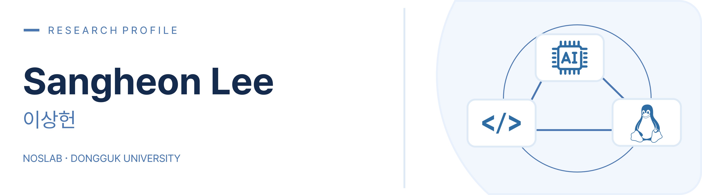

<!-- Blue research-profile banner: edit assets/header.svg to change its content. -->

  

  <strong>LLM Serving</strong> &nbsp;·&nbsp; <strong>Resource Scheduling</strong> &nbsp;·&nbsp; <strong>GPU Memory Management</strong> &nbsp;·&nbsp; <strong>Linux &amp; Storage Systems</strong>

  &nbsp;
  &nbsp;
  

 

I'm an M.S. student in Computer Engineering at **Dongguk University**, working with **[NOSLab (Next-generation Operating Systems Laboratory)](https://noslab.github.io/)**.

My research focuses on **LLM serving and inference systems**, **GPU resource scheduling and memory management**, and **Linux kernel and storage systems**.

## 🔬 Research Interests

- **LLM Serving & Inference Systems:** Prefill/Decode scheduling, tail latency, KV cache management, and GPU resource partitioning
- **AI Runtime & Training Systems:** Asynchronous memory transfers, compute–copy overlap, and lightweight checkpointing
- **Linux Kernel & Storage Systems:** eBPF-based I/O tracing, F2FS/Ext4, ZNS SSDs, and storage performance analysis

## 🛠️ Technical Skills

| Area | Technologies |
| --- | --- |
| AI / ML | PyTorch, vLLM, CUDA kernels |
| Programming | C/C++, Python, Shell |
| Systems & Tracing | Linux Kernel, eBPF, kprobe, blktrace, Ctags/Cscope |
| Storage | ZNS SSD, NVMeVirt, FEMU, Computational SSD |
| File Systems | F2FS, Ext4 |

## 🚀 Selected Research & Projects

### SpanMux: Scheduling and Dynamic Resource Management for LLM Serving
*Ongoing research*

- Designed separate **SRPT-based Prefill** and **FCFS-based Decode** scheduling paths in vLLM.
- Developed a Prefill/Decode multiplexing runtime combining **HBM–DRAM KV cache movement** with **SM partitioning**.
- Implemented asynchronous host–device memory transfers using pinned DRAM and CUDA copy streams.

### Lightweight Checkpointing for Deep Learning

- Designed a checkpoint pipeline that synchronizes only the model-state snapshot phase.
- Overlapped model training, quantization, and storage I/O to reduce checkpointing interference.

### Linux Kernel & Storage Performance Analysis

- Investigated F2FS segment allocation/cleaning and **LFS vs. SSR** under aged file-system layouts.
- Used eBPF and block-layer tracing to analyze I/O paths, latency, and request correlation.
- Studied ZNS SSD write buffering, zone management, and NAND parallelism.

## 📚 Publications

### Journal Articles

| Year | Paper | Venue | Role |
| --- | --- | --- | --- |
| 2026 | **ZAB: Fast and Efficient Write Buffer Algorithm for Optimizing Parallelism inside Zoned Namespace Storage Device** | IEEE Internet of Things Journal | Second Author |
| 2024 | **Check-QZP: A Lightweight Checkpoint Mechanism for Deep Learning Frameworks** | Applied Sciences (MDPI) | First Author |
| 2024 | **ReZNS: Energy and Performance-Optimal Mapping Mechanism for ZNS SSD** | Applied Sciences (MDPI) | Second Author |

### Conference Posters

| Year | Poster | Conference | Role |
| --- | --- | --- | --- |
| 2026 | 멀티테넌트 멀티턴 환경에서 LLM 인스턴스의 TTFT 꼬리 지연 분석 | 한국컴퓨터종합학술대회 | Presenter |
| 2024 | Ext4 및 F2FS의 Discard 명령에 따른 쓰기 성능 분석 | 한국컴퓨터종합학술대회 | Presenter |
| 2023 | 양자화 기반의 딥러닝 체크포인팅 기법 | 한국소프트웨어종합학술대회 | Presenter |

## 🎓 Education

- **Dongguk University** — M.S. in Computer Engineering *(Mar. 2025 – Feb. 2027, expected)*
- **Gachon University** — B.S. in Biomedical Engineering, double major in Computer Science *(Mar. 2018 – Feb. 2024)*

## 📖 Paper Reading & Seminars

A record of papers I have read and discussed in research seminars. **27 papers (2023–2026)**. Dates below indicate **seminar dates**, not publication dates.

<strong>2026 — 7 papers</strong>

| Seminar Date | Venue | Paper Title |
| --- | --- | --- |
| 2026-01-13 | SoCC'24 | QLM: Queue Management for Multi-Model LLM Serving |
| 2026-01-27 | FAST'25 | Mooncake: Trading More Storage for Less Computation — A KVCache-centric Architecture for Serving LLM Chatbot |
| 2026-02-26 | ASPLOS'25 | Accelerating LLM Serving for Multi-turn Dialogues with Efficient Resource Management |
| 2026-04-09 | ASPLOS'26 | PF-LLM: Large Language Model Hinted Hardware Prefetching |
| 2026-06-05 | ATC'25 | Resource Multiplexing in Tuning and Serving Large Language Models |
| 2026-07-09 | NeurIPS'24 | FlashAttention-3: Fast and Accurate Attention with Asynchrony and Low-Precision |
| 2026-07-29 | NSDI'26 | FastServe: Iteration-Level Preemptive Scheduling for Large Language Model Inference |

<strong>2025 — 2 papers</strong>

| Seminar Date | Venue | Paper Title |
| --- | --- | --- |
| 2025-01-06 | FAST'22 | exF2FS: Transaction Support in Log-Structured Filesystem |
| 2025-12-30 | SC'25 | Phoenix: A Refactored I/O Stack for GPU Direct Storage without Phony Buffers |

<strong>2024 — 12 papers</strong>

| Seminar Date | Venue | Paper Title |
| --- | --- | --- |
| 2024-01-10 | FAST'23 | CJFS: Concurrent Journaling for Better Scalability |
| 2024-01-23 | FAST'23 | On Stacking a Persistent Memory File System on Legacy File Systems |
| 2024-02-07 | FAST'22 | InfiniFS: An Efficient Metadata Service for Large-Scale Distributed Filesystems |
| 2024-02-23 | OSDI'23 | SingularFS: A Billion-Scale Distributed File System Using a Single Metadata Server |
| 2024-03-28 | HotStorage'22 | Fair I/O Scheduler for Alleviating Read/Write Interference by Forced Unit Access in Flash Memory |
| 2024-05-16 | TCAD'21 | iTRIM: I/O-Aware TRIM for Improving User Experience on Mobile Devices |
| 2024-07-18 | HotStorage'24 | Context-aware Prefetching for Near-Storage Accelerators |
| 2024-08-08 | ASPLOS'24 | LazyBarrier: Reconstructing Android IO Stack for Barrier-Enabled Flash Storage |
| 2024-09-10 | FAST'24 | We Ain’t Afraid of No File Fragmentation: Causes and Prevention of Its Performance Impact on Modern Flash SSDs |
| 2024-10-15 | Middleware'22 | Light-GC: A Lightweight and Efficient Garbage Collection Scheme for Embedded File Systems |
| 2024-11-21 | TCAD'20 | An Efficient Directory Entry Lookup Cache With Prefix-Awareness for Mobile Devices |
| 2024-12-16 | TOS'19 | Mitigating Synchronous I/O Overhead in File Systems on Open-Channel SSDs |

<strong>2023 — 6 papers</strong>

| Seminar Date | Venue | Paper Title |
| --- | --- | --- |
| 2023-06-29 | EuroSys'23 | NearPM: A Near-Data Processing System for Storage-Class Applications |
| 2023-07-13 | EuroSys'23 | Fast and Efficient Model Serving Using Multi-GPUs with Direct-Host-Access |
| 2023-07-27 | NSDI'22 | Check-N-Run: A Checkpointing System for Training Deep Learning Recommendation Models |
| 2023-08-10 | FAST'21 | CheckFreq: Frequent, Fine-Grained DNN Checkpointing |
| 2023-10-11 | FAST'22 | Hardware/Software Co-Programmable Framework for Computational SSDs to Accelerate Deep Learning Service on Large-Scale Graphs |
| 2023-12-05 | TPDS'23 | Multi-Tier GPU Virtualization for Deep Learning in Cloud-Edge System |

